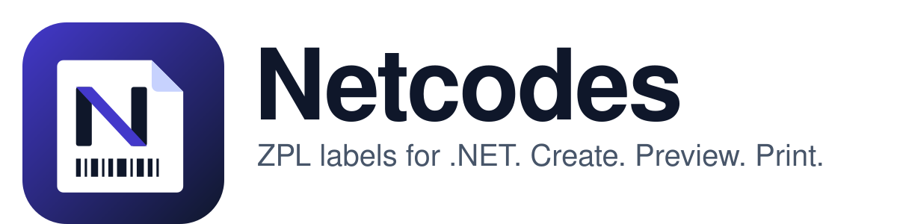
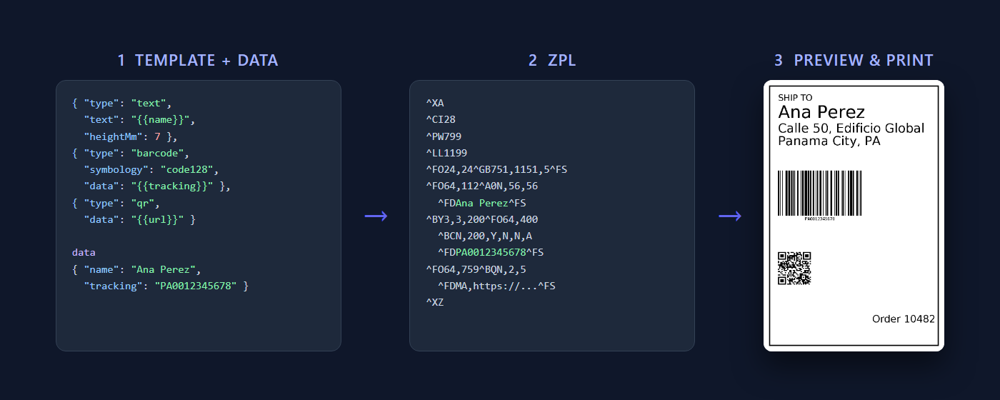
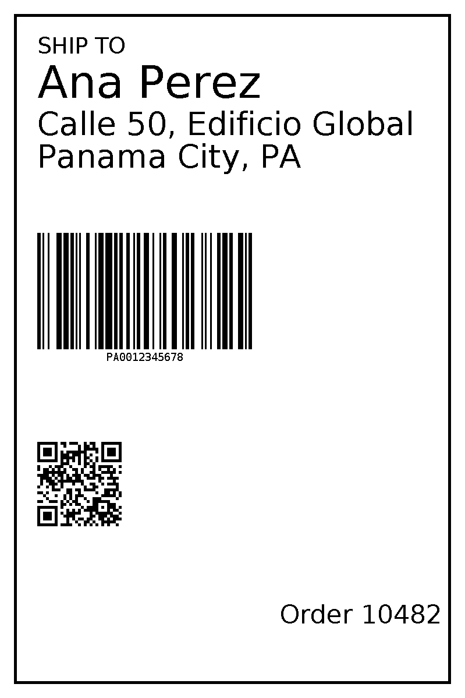
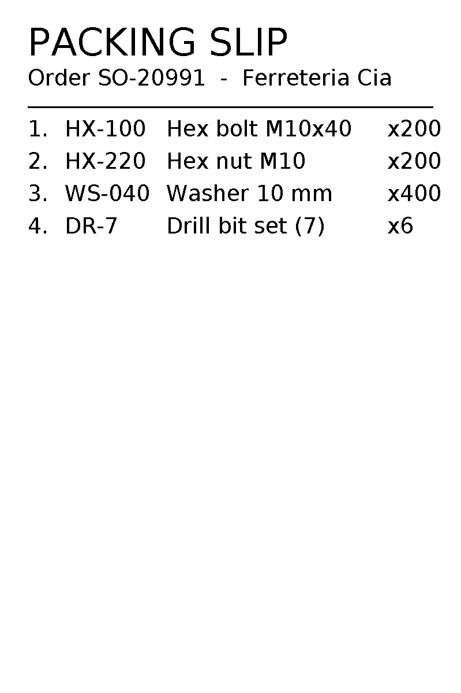
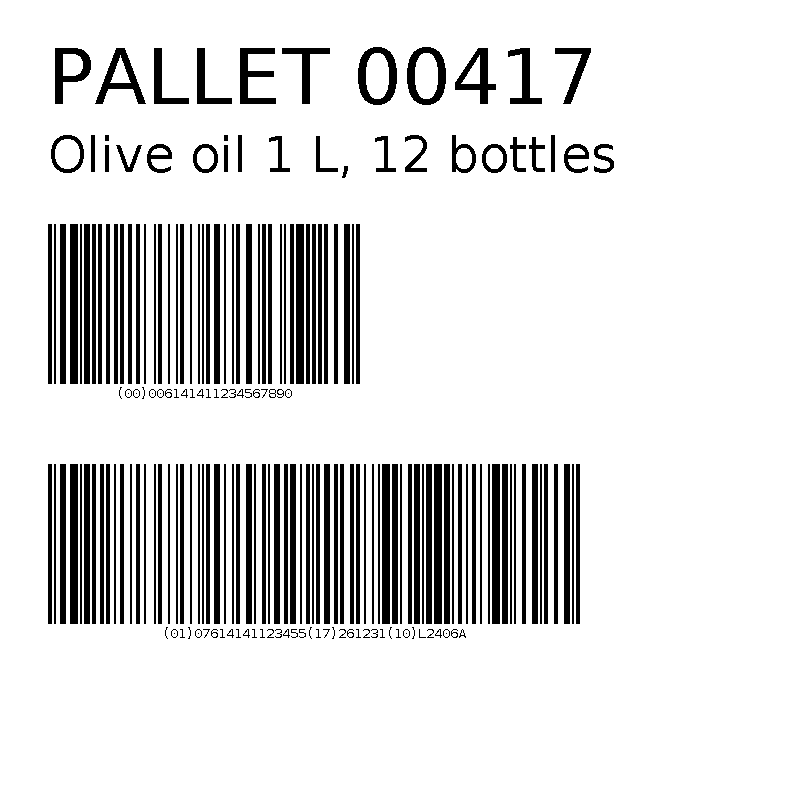
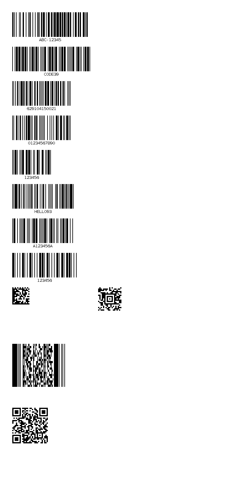
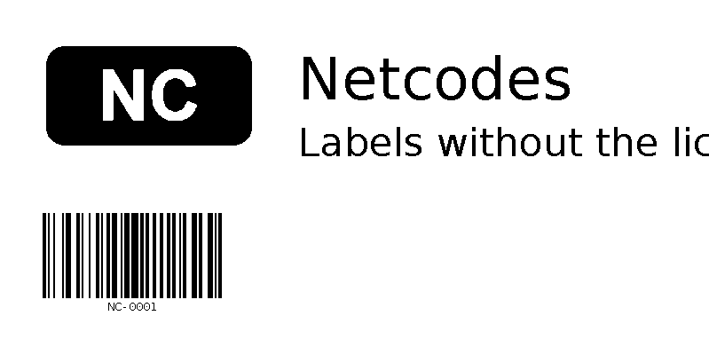

<div align="center">

<picture>
  <source media="(prefers-color-scheme: dark)" srcset="docs/brand/logo-dark.svg">
  
</picture>

<br>

**Design, preview and print Zebra labels from .NET, in a few lines of code.**<br>
Open source. No server. No per-seat licence checks.

<br>

[](https://github.com/P4Software/Netcodes/actions/workflows/ci.yml)
[](LICENSE)


[**Your first label in 10 minutes**](docs/guide/first-label-for-beginners.md) &nbsp;·&nbsp;
[Guides](#the-guides) &nbsp;·&nbsp;
[What works today](#what-works-today) &nbsp;·&nbsp;
[Security](SECURITY.md)

<br>



</div>

<br>

## Why Netcodes

Printing a Zebra label from your own software usually means choosing between two extremes: a free preview website with
no templates and no printing, or a commercial label SDK that costs thousands per developer per year and ties you to its
own designer.

Netcodes is the middle path. You describe a label as plain JSON, merge your data into it, and get ZPL, a PNG preview
and a printed label, all inside your own .NET application.

|  |  |
|---|---|
| **Open source** | Apache-2.0. Use it, change it and ship it in commercial products. |
| **Code first** | Templates are JSON files you can keep in Git, review and test. |
| **See before you print** | The preview is drawn from the very ZPL that is sent to the printer. |
| **Safe by default** | Printing is a dry run until you ask for a real print. Bad input becomes a warning, never a crash. |
| **Tested against the real thing** | Compared with Labelary's renderer, and printed on a Zebra ZD621R. |
| **Small** | A handful of projects with few dependencies, small enough to read. |

## See it

<table>
  <tr>
    <td align="center"><br><sub><b>Shipping label</b><br>text, Code 128, QR</sub></td>
    <td align="center"><br><sub><b>Packing slip</b><br>repeated rows</sub></td>
    <td align="center"><br><sub><b>Pallet label</b><br>GS1-128 (SSCC)</sub></td>
    <td align="center"><br><sub><b>Every barcode</b><br>13 symbologies</sub></td>
    <td align="center"><br><sub><b>Pictures</b><br>logos as graphics</sub></td>
  </tr>
</table>

Each of these is a real example in [`docs/guide/examples`](docs/guide/examples), and the test suite runs every one.

## Quick start

New to this? Follow the [step-by-step guide for beginners](docs/guide/first-label-for-beginners.md). It assumes
nothing.

Already a .NET developer? You need the .NET 10 SDK. Until the first NuGet release, add a project reference to
`src/Netcodes.Core/Netcodes.Core.csproj`.

A label is a template (JSON, with `{{placeholders}}`) plus your data (JSON):

```csharp
using Netcodes;
using Netcodes.Printing;
using Netcodes.Template;

var template = LabelTemplate.FromJson(File.ReadAllText("shipping-label.template.json"));
var data = File.ReadAllText("shipping-label.data.json");

var engine = new NetcodesEngine();

// 1. Template + data -> ZPL. A missing value never throws: it prints empty and comes back as a warning.
var zpl = engine.GenerateZpl(template, data);
foreach (var warning in zpl.Warnings) Console.WriteLine(warning);

// 2. Preview the ZPL as a PNG (one pixel per printer dot).
var preview = engine.Preview(zpl.Zpl);
File.WriteAllBytes("label.png", preview.Png);

// 3. Print. This is a DRY RUN by default: the request is checked, nothing is sent to the printer.
var printer = new PrinterTarget("Dock 1", Host: "192.168.1.50");
var result = await engine.PrintAsync(printer, zpl.Zpl, copies: 1);
Console.WriteLine(result.Message);

// To really print, say so explicitly:
// await engine.PrintAsync(printer, zpl.Zpl, copies: 1, dryRun: false);
```

The two files used above are in [`docs/guide/examples`](docs/guide/examples). The template is plain JSON:

```json
{
  "name": "shipping-label",
  "widthMm": 100,
  "heightMm": 150,
  "dpi": 203,
  "elements": [
    { "type": "box", "x": 3, "y": 3, "widthMm": 94, "heightMm": 144, "borderMm": 0.6 },
    { "type": "text", "x": 8, "y": 14, "text": "{{name}}", "heightMm": 7 },
    { "type": "barcode", "symbology": "code128", "x": 8, "y": 50, "data": "{{tracking}}", "heightMm": 25, "moduleWidth": 3 },
    { "type": "qr", "x": 8, "y": 95, "data": "{{url}}", "size": 5, "errorCorrection": "M" }
  ]
}
```

You can also skip templates and preview or print ZPL you wrote by hand: `engine.Preview(zpl)`.

## What works today

| Area | What is there |
|---|---|
| Templates | text (wrapping, fonts), boxes and lines, barcodes, QR, GS1-128, pictures, repeated rows (packing-slip lines), rotation 0/90/180/270 |
| Barcodes | Code 128, Code 39, Code 93, Codabar, MSI, EAN-13, UPC-A, Interleaved 2 of 5, QR, Data Matrix, Aztec, PDF417, GS1-128 (SSCC, GTIN, lot, dates) |
| Pictures | PNG, JPEG, GIF, BMP, WebP, turned into black-and-white `^GF` graphics |
| Preview | ZPL to PNG, also for ZPL you wrote yourself; unknown commands become warnings, never errors |
| Printing | network printers on port 9100, or a Windows printer queue; dry run by default |
| Printer settings | speed, darkness, media type, copies, label shift, print mode, media tracking, inverted print, save/recall settings |

## Roadmap

| | |
|---|---|
| ✅ **Engine** | templates, ZPL generation, preview, printing (this repository) |
| 🔜 **NuGet packages** | `dotnet add package`, with Linux and macOS preview support |
| 🔜 **Web API** | the same engine as an HTTP service, with an API client package |
| 🔜 **Visual designer** | a drag-and-drop label designer you can embed in your own application (planned as a separate commercial product) |
| 💭 **EPL and CPCL** | other printer languages |

The ZPL commands that are not understood yet are listed under [not supported](docs/guide/zpl-support.md#not-supported-yet).

## The guides

- [Your first label for beginners](docs/guide/first-label-for-beginners.md): zero to a printed label, step by step
- [Getting started](docs/guide/getting-started.md): the same ideas in more depth, and the example gallery
- [Template reference](docs/guide/template-reference.md): every element and every setting
- [Printing](docs/guide/printing.md): printers, dry runs, copies, printer settings, safety
- [ZPL support](docs/guide/zpl-support.md): what the preview understands, and how close it is to a real printer
- [Limits and messages](docs/guide/limits-and-messages.md): the size limits, and what each warning means

## Good to know

- **The ZPL is the truth.** A template becomes ZPL, and the preview draws that ZPL, so what you preview is what is sent.
  The preview approximates the printer's built-in fonts; barcodes and graphics are drawn dot for dot. Compared with Labelary,
  the examples differ in roughly 1 to 4 percent of their pixels, mostly font shapes.
- **Safe by default.** Printing is a dry run until you ask for a real one. ZPL, printer names and template JSON are
  treated as untrusted input and have size limits, so a bad label cannot hang or exhaust a service built on the library.
- **Match the resolution.** A template's `dpi` must match the printer (203 or 300 dpi is typical), or the label comes out
  the wrong physical size.
- **Building a service?** The library only checks that a printer address is well formed. If callers can name a printer, let
  them choose only from printers you listed yourself, never an address they typed.

## Building and testing

```
dotnet build
dotnet test --filter "Category!=Labelary"
```

A few extra tests compare the preview with Labelary's and need internet: `dotnet test --filter "Category=Labelary"`.
The examples in the guides are run by the test suite, so they stay correct. See [CONTRIBUTING](CONTRIBUTING.md) to help.

## Licence

The Netcodes engine (everything in this repository) is open source under the [Apache License 2.0](LICENSE): free to use,
change and ship, including in commercial products. Third-party components and their licences are listed in
[NOTICE](NOTICE).

<div align="center">
<br>
<sub>Made by <b>P4 Software</b></sub>
</div>
