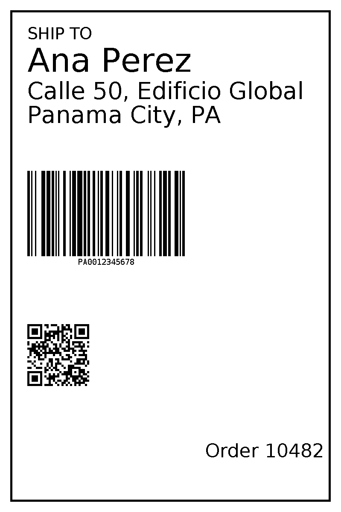
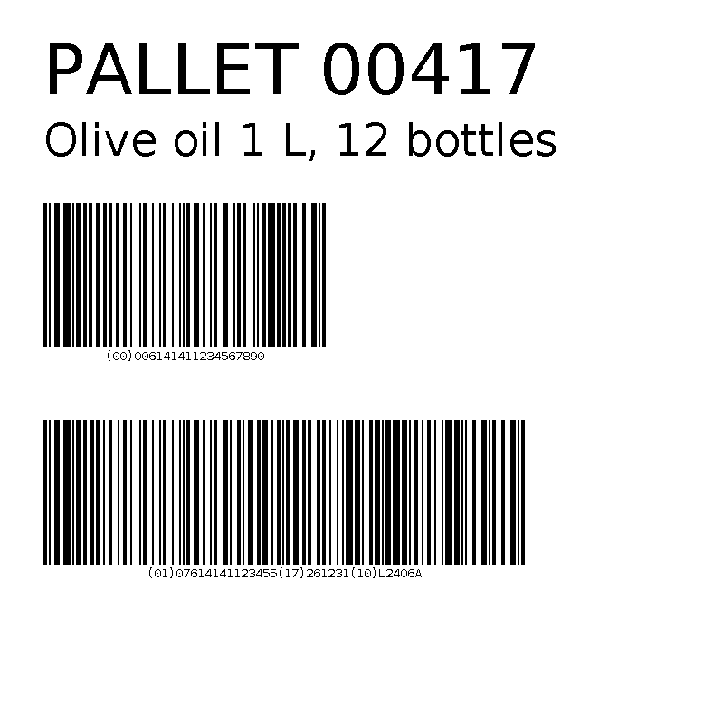
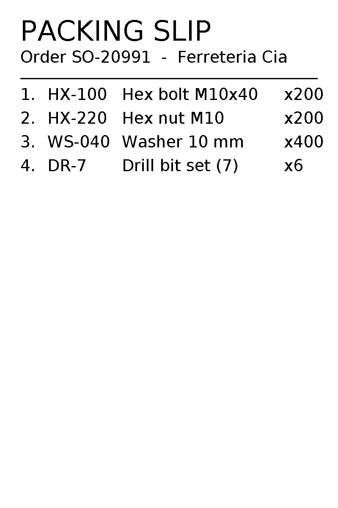
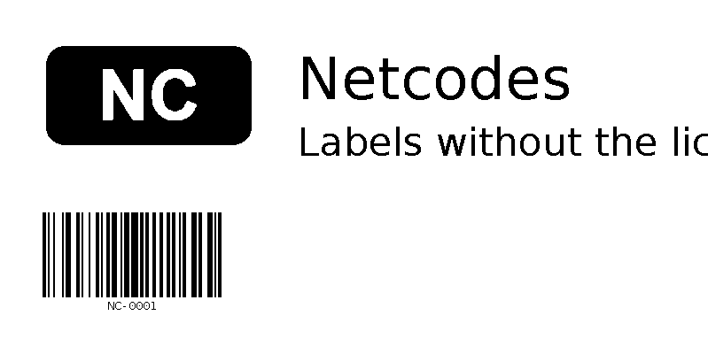
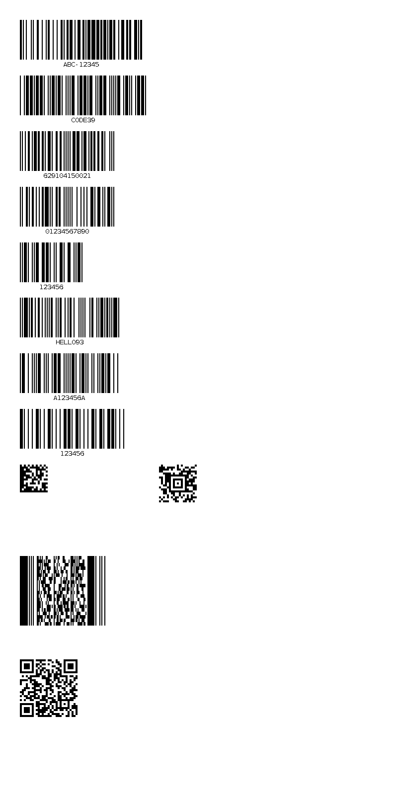

# Getting started

This guide takes you from nothing to a printed label. Every example here is a real file in
[`examples/`](examples), and the test suite runs each one, so they stay correct.

## 1. What you need

- The .NET 10 SDK.
- This repository. Until the first NuGet release, add a project reference to
  `src/Netcodes.Core/Netcodes.Core.csproj` from your own project. It brings in the template model, the ZPL engine and
  the printing code.
- Windows works out of the box. On Linux or macOS the PNG preview needs the SkiaSharp native files for that system
  (not bundled yet); generating ZPL and printing to a network printer do not need them.
- A Zebra printer, only when you want to print. You do not need one to generate and preview labels.

## 2. How it fits together

```
template (JSON) ──┐
                  ├─► GenerateZpl ─► ZPL text ─► Preview ─► PNG
data (JSON)  ─────┘                       │
                                          └──────► PrintAsync ─► printer
```

- The **template** says what is on the label and where, in millimetres. It contains `{{placeholders}}`.
- The **data** is a JSON object whose values fill the placeholders.
- **ZPL** is what the printer understands. Netcodes writes it for you, and draws the preview from that same ZPL, so the
  preview shows what will be printed.
- You can also bring your own ZPL (hand-written, or from another tool) and preview or print it directly.

## 3. Your first label

Save this as `hello.template.json`:

```json
{
  "name": "hello",
  "widthMm": 100,
  "heightMm": 50,
  "dpi": 203,
  "elements": [
    { "type": "text", "x": 6, "y": 6, "text": "Hello, {{name}}", "heightMm": 8 },
    { "type": "barcode", "symbology": "code128", "x": 6, "y": 22, "data": "{{code}}", "heightMm": 15, "moduleWidth": 3 }
  ]
}
```

and `hello.data.json`:

```json
{ "name": "Ana", "code": "HELLO-0001" }
```

Then in C#:

```csharp
using Netcodes;
using Netcodes.Template;

var engine = new NetcodesEngine();
var template = LabelTemplate.FromJson(File.ReadAllText("hello.template.json"));

var zpl = engine.GenerateZpl(template, File.ReadAllText("hello.data.json"));
Console.WriteLine(zpl.Zpl);                       // the ZPL
foreach (var warning in zpl.Warnings)             // anything worth knowing
    Console.WriteLine("Note: " + warning);

File.WriteAllBytes("hello.png", engine.Preview(zpl.Zpl).Png);
```

Open `hello.png` to see the label. Change `{{name}}` in the data and run again.

## 4. What the settings mean

- **`widthMm` and `heightMm`** are the physical label size.
- **`dpi`** is the printer's resolution: 152, 203, 300 or 600 dots per inch. It must match your printer. Most Zebra desktop
  printers are 203 or 300 dpi. A 203 dpi template sent to a 300 dpi printer prints about two thirds of the size you drew.
- **`x` and `y`** are millimetres from the label's top-left corner.
- **`moduleWidth`** is the width of the narrowest bar, in printer dots. At 203 dpi, 2 or 3 is typical; at 300 dpi, 3 or 4.
  Too small and a scanner cannot read it.

## 5. Missing data does not break a label

If your data has no `name`, the label still comes out, with that spot empty, and you get a warning:

```
The field {{name}} has no value in your data. It will print empty.
```

So check `zpl.Warnings` before you print. The messages are plain language and say what to do next; the full list is in
[Limits and messages](limits-and-messages.md).

A template or data file that is not valid JSON, or a template with an impossible setting (no name, a size of zero), is
refused with a `TemplateException` whose message lists every problem.

## 6. Preview

```csharp
var preview = engine.Preview(zpl.Zpl);
File.WriteAllBytes("label.png", preview.Png);   // one pixel per printer dot
```

`preview.Warnings` lists anything the preview could not draw. The preview also works for ZPL you wrote yourself:

```csharp
var result = engine.Preview("^XA^FO50,50^A0N,40,40^FDHello^FS^XZ");
```

## 7. Print

```csharp
using Netcodes.Printing;

var printer = new PrinterTarget("Dock 1", Host: "192.168.1.50");   // Zebra printers listen on port 9100
var result = await engine.PrintAsync(printer, zpl.Zpl, copies: 1);   // dry run: checks only
Console.WriteLine(result.Message);

// When the dry run looks right, print for real:
await engine.PrintAsync(printer, zpl.Zpl, copies: 1, dryRun: false);
```

Printing is a dry run until you pass `dryRun: false`. See [Printing](printing.md) for printer addresses, Windows printer
queues, copies and printer settings.

## 8. Example gallery

Each example is a template and a data file in [`examples/`](examples), rendered here by the engine.

### Shipping label: text, box, Code 128, QR

[`shipping-label.template.json`](examples/shipping-label.template.json),
[`shipping-label.data.json`](examples/shipping-label.data.json)



The ZPL it produces ([`shipping-label.zpl.txt`](images/shipping-label.zpl.txt)) starts like this:

```
^XA
^CI28
^PW799
^LL1199
^LH0,0
^FO24,24^GB751,1151,5^FS
^FO64,64^A0N,28,28^FDSHIP TO^FS
...
```

### Pallet label: GS1-128 with SSCC, GTIN, expiry and lot

[`pallet-sscc.template.json`](examples/pallet-sscc.template.json), [`pallet-sscc.data.json`](examples/pallet-sscc.data.json)



You give the identifiers by name (`sscc`, `gtin`, `lot`, `expiry`...). Netcodes adds the check digits and the `(00)(01)(17)(10)`
structure. Two barcodes are used because four identifiers in one barcode would not fit the width of this label.

### Packing slip: a row for every line

[`packing-slip.template.json`](examples/packing-slip.template.json),
[`packing-slip.data.json`](examples/packing-slip.data.json)



The `repeat` element prints its child elements once for each item of a list in your data. Inside it, `{{item.sku}}` reads
the current item and `{{index}}` is the row number.

### Logo and picture

[`logo-label.template.json`](examples/logo-label.template.json), [`logo-label.data.json`](examples/logo-label.data.json)



The picture travels in the data as base64 text (see the `logo` value in the data file), and the template places it with
`{{logo}}`.

### Every barcode type

[`all-barcodes.template.json`](examples/all-barcodes.template.json)



From the top: Code 128, Code 39, EAN-13, UPC-A, Interleaved 2 of 5, Code 93, Codabar, MSI, Data Matrix, Aztec, PDF417, QR.

## Next

- [Template reference](template-reference.md): every element and setting
- [Printing](printing.md)
- [ZPL support](zpl-support.md)
- [Limits and messages](limits-and-messages.md)
